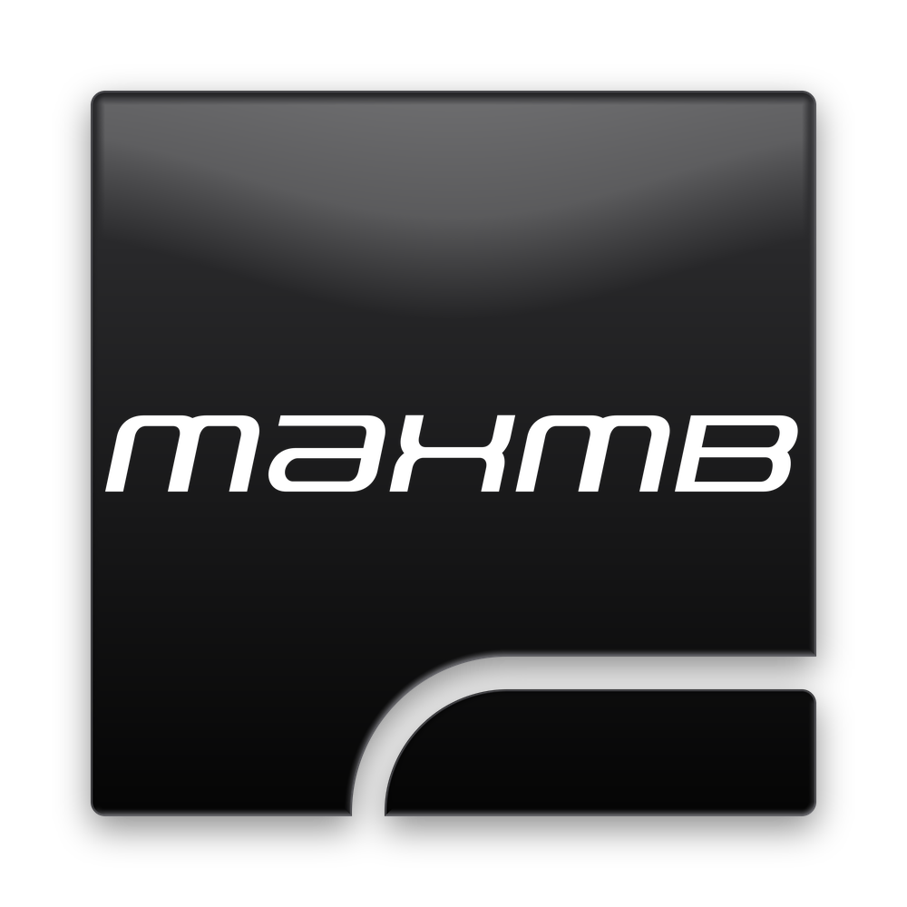
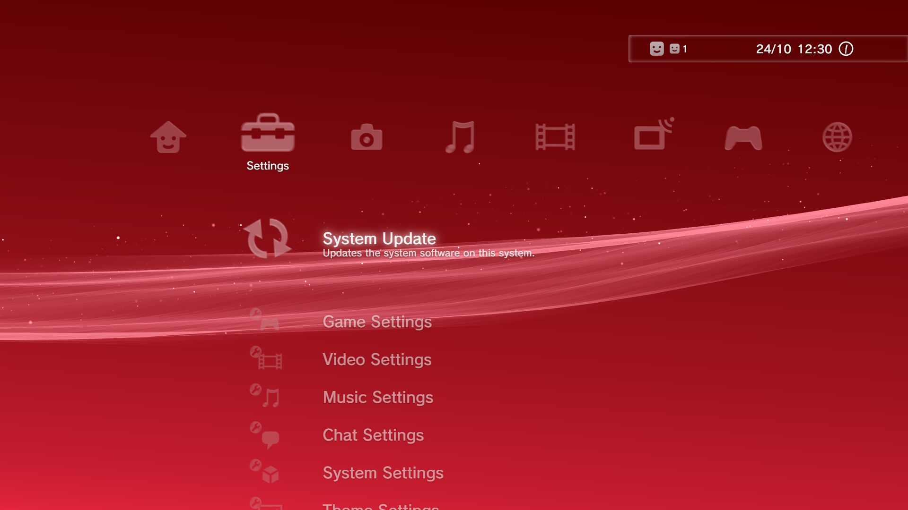
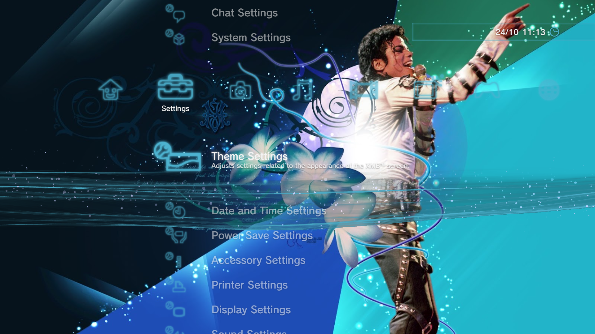
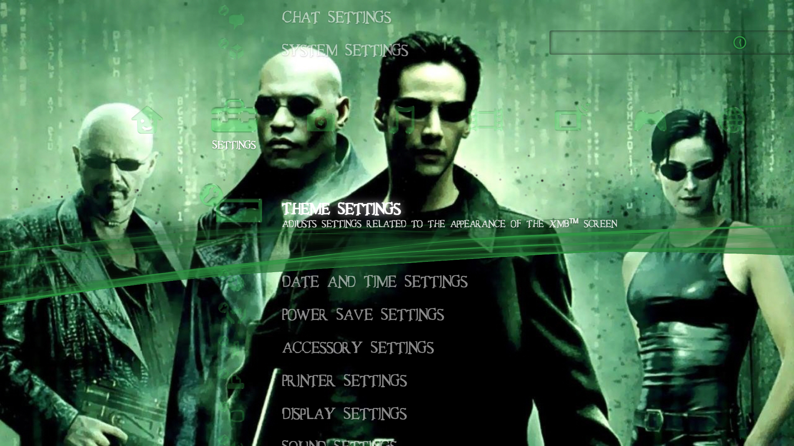
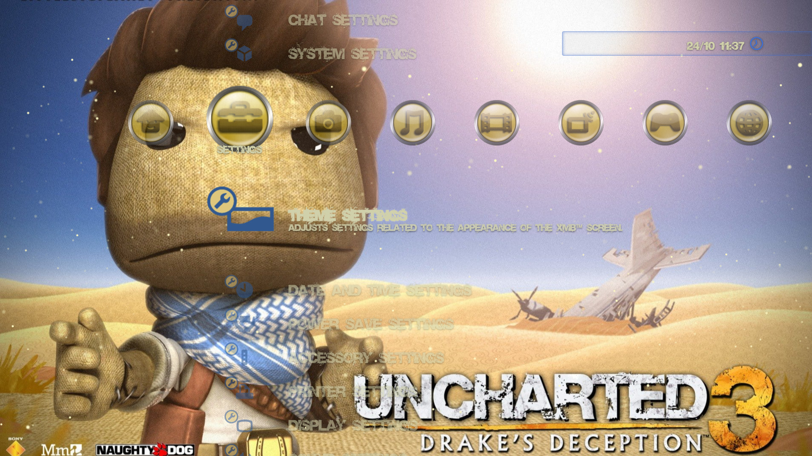
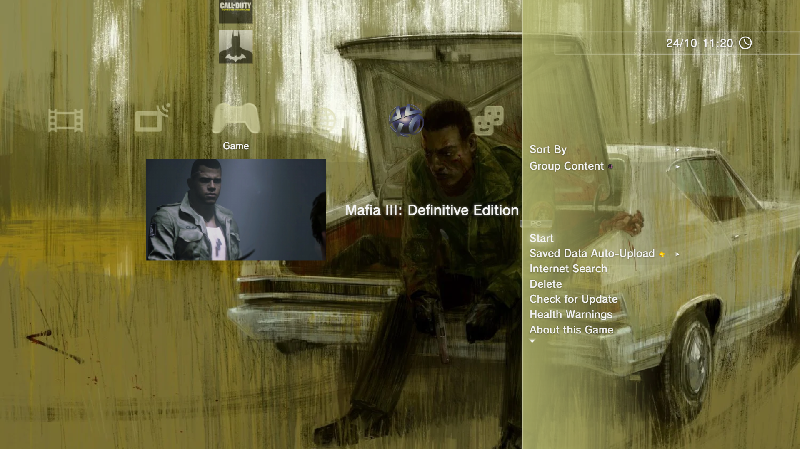
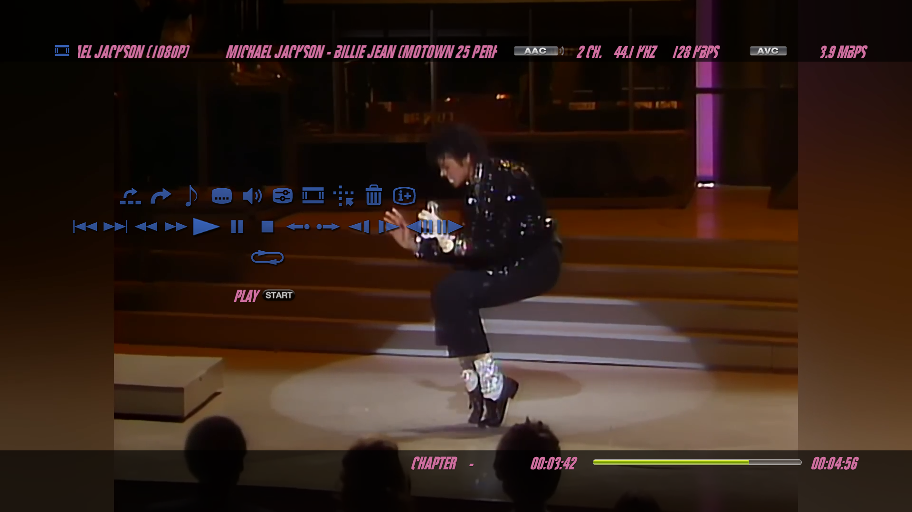
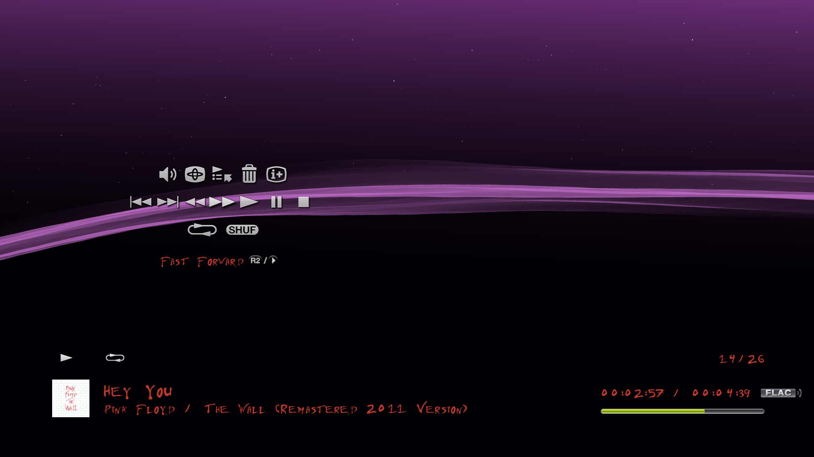
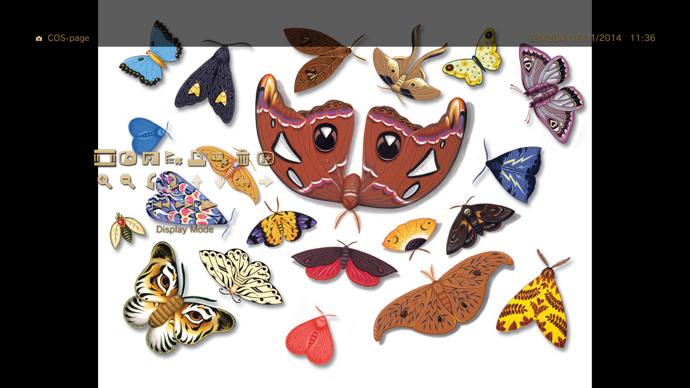
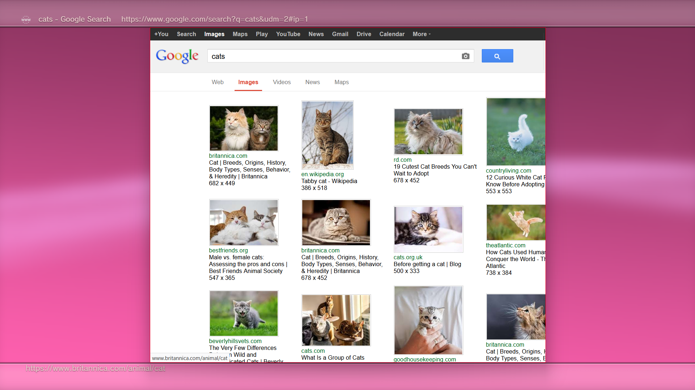

<p align="center">
  
</p>

<h1 align="center">MaXMB</h1>

<p align="center"><b>The XMB, taken to the Max.</b><br>
A PlayStation&nbsp;3 Style XrossMediaBar for Windows. Your games, music, photos, videos and the web, in one controller friendly system.</p>

---

## About this project and AI use

MaXMB was made with the help of AI. The code was mainly written by an AI assistant (Anthropic's Claude), working from my instructions, reviews and test results.

What I mainly worked on:

- **The idea and the direction:** What the system is, what it does and how every part should behave.
- **Faithfulness to the original XMB:** Reference captures of a real PS3's XMB menu in action and reverse engineering the look and behavior of the XMB's menus through testing, observation and hypothesis.
- **Design:** The MaXMB name and icon, the layouts, and every visual cohesion decision regarding menus and the overall look of the system.
- **Testing:** Every build on Windows, with a controller and keyboard and mouse, plus the bug reports that shape each fix.
- **Gathering what's credited below:** The tools, icon packs, avatars and add-ons the system uses or recommends.

---

## Gallery

<p align="center">
  
</p>

<p align="center">
    
</p>

<p align="center">
   
   
  
</p>

---

## Features

**A faithful recreation**
- The cross-shaped menu, the intro, the month-colored wave and sparkles, the info box, the Triangle option panels and the XMB's own sounds among others.
- Works fully with a controller (DualShock 3, DualShock 4, DualSense and Xbox controllers), as well as with a keyboard and mouse. Every keyboard key can be rebound.
- Users have their own themes, settings and a local PlayStation™Network style account system with avatars, trophy levels, player cards and a Friends list.

**Fully customizable**
- Background colors, photos or videos as backgrounds, green screen and transparent pictures as overlay, and shuffling playlists of pictures and videos.
- Fully adjustable wave and sparkles look and behavior, icon colors, icon styles, text and color personalization.
- Icon Sets and Sound Effect Sets, where you can drop in replacement icons or sounds.
- **Custom Sections:** Add your own categories to the XMB, with your own icons, subsections and folders.
- **Friends Personalization:** Choose how many friends appear and design your own friend cards.

**Themes**
- Loads real PS3 themes (`.p3t`), animated backgrounds included, with control over which parts of a theme you use.
- Save your own look as a Custom Theme (A `.zip` you can share with other MaXMB Users), save presets, or extract everything a PS3 theme contains.

**Games**
- Game folders with their own icon, animated preview, background and music, just like on the XMB.
- Automatic game recognition from your folders, RPCS3 support (PS3 games start straight from the XMB), and art from SteamGridDB, TheGamesDB and RAWG using your own API keys.

**Media players**
- **Music Player:** With playlists, shuffle and repeat among other features.
- **Photo Viewer:** With zoom, rotation, trimming and slideshows. It also reads PDFs and comics page by page.
- **Video Player:** With Scene Search, subtitles, instant replay, slow motion and custom video icons.
- Pre-Loading of songs and videos for smooth playback.

**Web browsing inside the system**
- An Internet Browser and Internet Search powered by LibreWolf, controlled entirely with a controller, with the On-Screen Keyboard for typing.

**Built to stay out of your way**
- Everything lives in the system's own folders. Temporary files are the only ones that go to the Windows Temp folder.
- Power saving options for slower computers, a HUD toggle and Screenshot support.

---

## About the PlayStation™Network features

The PlayStation™Network in MaXMB is **completely local**. For now it doesn't connect to anything, not to Sony's PlayStation™Network, nor to any other online services.

- Accounts, Online IDs, passwords, avatars, trophy levels, player cards and friends are all made and kept on your own computer, in the system's folder.
- Friends are generated by the system or designed by you with Friend Personalization. They aren't real people.
- Signing in or signing up never sends anything over the Internet.

---

## Planned features

These are still to be added:

- [ ] **Steam Friend Integration**
- [ ] **Trophy Integration**

---

## Requirements

- Windows 10 or 11.
- **FFmpeg:** Needed for converting videos, video icons, songs and PS3 game previews and music.
- **LibreWolf:** Needed for the Internet Browser, Internet Search and YouTube.

See the MaXMB Manual for setup and controls.

---

## Community and support

- **Bug reports:** Post what happened along with the MaXMB.log file inside of `content/Logs/`. It's made fresh every time the system starts, so if you've booted it again since the problem, send `MaXMB (previous).log` instead.
- **Ko-fi:** If you like what I make and want to support me as a creator, you can [buy me a coffee on Ko-fi](https://ko-fi.com/maxibono). Donations are completely optional, they support me rather than any specific project, and they don't unlock anything, as MaXMB is and will stay free.

---

## Running from the source

If you'd rather not use the installer, or want to test or change the system yourself, you can run it straight from this repository.

**What you need** (Windows 10 or 11)

| Tool | Why | Where |
|---|---|---|
| **Microsoft C++ Build Tools** | Compiling the system on Windows. Pick the **"Desktop development with C++"** workload in the installer. | [Visual Studio Build Tools](https://visualstudio.microsoft.com/visual-cpp-build-tools/) |
| **Rust** (Stable, 1.77 or newer, MSVC toolchain) | The system's back end. If Rust was already installed, run `rustup default stable-msvc`. | [rustup](https://www.rust-lang.org/tools/install) |
| **Node.js** (LTS) | Runs the Tauri tools that build and start the system. | [nodejs.org](https://nodejs.org) |
| **Microsoft Edge WebView2** | What the system is displayed with. Already part of Windows 10 (1803 and later) and 11. If it's missing, install the "Evergreen Bootstrapper". | [WebView2 Runtime](https://developer.microsoft.com/microsoft-edge/webview2/) |

- **FFmpeg:** Put `ffmpeg.exe` in `src-tauri/resources/ffmpeg/` (It's then included in your builds), or have it on your PATH.
- **LibreWolf:** Put the portable version in `content/Browser/LibreWolf/`, so `librewolf.exe` is in that folder.

**Run it**

```bat
git clone https://github.com/MaxiBono/MaXMB
cd <the repository's folder>
npm install
npm run dev
```

`npm install` gets the Tauri tools, and `npm run dev` compiles and starts the system. The first start takes a few minutes while Rust compiles everything, but later starts are much faster. When run this way, the system keeps everything in the `content` folder at the root of the repository.

**If the build says the Tauri versions don't match**

The npm packages have to be on the same version as the Rust ones the system is built with (`src-tauri/Cargo.lock`): Tauri 2.11, the dialog plugin 2.7 and the autostart plugin 2.5. `npm install` already picks those, but if newer ones got installed (An error lists the versions it found), install the matching ones:

```bat
npm install @tauri-apps/api@~2.11.0 @tauri-apps/plugin-dialog@~2.7.0 @tauri-apps/plugin-autostart@~2.5.0
```

**Make your own installer**

```bat
npm run build
```

The installers end up in `src-tauri/target/release/bundle/` (`nsis` for the .exe installer, `msi` for the .msi). Building the .msi needs VBScript turned on in Windows (Settings > Apps > Optional features > More Windows features).

Use the **.exe installer** (`nsis`) if possible to install the system. It installs for your Windows user in a folder the system can write to, which it needs because it keeps everything (Users, settings, shortcuts, logs, etc) in its own `content` folder. The **.msi** installs into `Program Files`, where Windows doesn't let programs write, so the system can't save anything there unless it's run as administrator.

---

## Credits

**Code included in MaXMB**

| Project | Used for | License |
|---|---|---|
| [linkev/PlayStation-3-XMB](https://github.com/linkev/PlayStation-3-XMB) | The wave and sparkles (Adapted) | MIT, © 2025 Mart |
| [Callum-Bell/DeckyXMB](https://github.com/Callum-Bell/DeckyXMB) | PS3 theme (`.p3t`) reading and animated theme backgrounds (Adapted) | BSD 3-Clause, © 2026 |
| [PDF.js](https://github.com/mozilla/pdf.js) (Mozilla) | Reading PDFs | Apache 2.0 (`src/vendor/pdfjs-LICENSE.txt`) |
| [fflate](https://github.com/101arrowz/fflate) | Reading comics and theme files | MIT, © 2026 Arjun Barrett (`src/vendor/fflate-LICENSE.txt`) |
| [Tauri](https://tauri.app) and the Rust crates in `src-tauri/Cargo.toml` (lofty, image, imagesize, zip, flate2, serde, chrono and others) | The system's foundation | Their own licenses (MIT / Apache 2.0) |

**Tools the system works with** (Downloaded separately, not included)

- [FFmpeg](https://ffmpeg.org): Windows builds from [gyan.dev](https://www.gyan.dev/ffmpeg/builds/).
- [LibreWolf](https://librewolf.net/): The engine behind the Internet Browser.

**Recommended browser add-ons**

- [Project VORAPIS](https://vorapis.pages.dev/#/): A YouTube frontend with YouTube's 2013 layout.
- [StarTube](https://github.com/lightbeam24/StarTube) by lightbeam24: YouTube layouts from 2008 to 2024, made to work with VORAPIS.
- [Gplex Extended](https://gplexextended.com/): Google services styled as they looked in the year you choose.
- [uBlock Origin Lite](https://github.com/uBlockOrigin/uBOL-home): Ad and content blocking.

**Pictures and sounds**

- **PSN avatars:** The PS3 avatar archive by [lI-Isekai-Il](https://github.com/lI-Isekai-Il/PS3-Avatars-Edat) ([Google Drive mirror](https://drive.google.com/drive/folders/1WDtRgEo-u2jQkYRPPEdh_2azDEcbqQdE)).
- **Default PSN avatars:** From [this AcidMods forum thread](https://www.acidmods.com/forum/index.php?topic=33596.0).
- **Default User avatars:** From [The Spriters Resource](https://www.spriters-resource.com/playstation_3/systembios/asset/208247/) (PlayStation 3 System BIOS).
- **Flat Icons:** Mostly the [Sony PS3 XMB Icons Pack](https://www.deviantart.com/mr-billionaire/art/Sony-PS3-XMB-Icons-Pack-139829567) by mr-billionaire.
- **Background color references:** [AYZAK94](https://www.youtube.com/@AYZAK94) on YouTube, used to match the default background colors.
- **PS4 Sounds:** The "PS4 Sounds" Sound Effect Set comes from the PS3 theme [Go-Tobun no Hanayome](http://www.ps3-themes.com/comics-anime/go-toubun-no-hanayome-slideshow.html) by [AnimugenZ](https://www.youtube.com/channel/UCkwbibnjwAFnQITFDALGcHg), from PS3-Themes.com.
- **Startup sound reference:** [PlayStation 3 Startup Boot Sound Effect](https://www.youtube.com/watch?v=s3554Db2rrs) used as the boot sound effect and as the buffering sound.
- **Font:** The XMB's font, "SCE-PS3 Rodin LATIN" (© 2006 Fontworks Japan, Inc.), taken from the PS3.
- **Game art:** Downloaded through SteamGridDB, TheGamesDB and RAWG belongs to its authors and is subject to each site's terms. RAWG data and images are from [RAWG](https://rawg.io).

<details>
<summary><b>License texts</b></summary>

**linkev/PlayStation-3-XMB** (MIT License)

```
Copyright (c) 2025 Mart

Permission is hereby granted, free of charge, to any person obtaining a copy
of this software and associated documentation files (the "Software"), to deal
in the Software without restriction, including without limitation the rights
to use, copy, modify, merge, publish, distribute, sublicense, and/or sell
copies of the Software, and to permit persons to whom the Software is
furnished to do so, subject to the following conditions:

The above copyright notice and this permission notice shall be included in all
copies or substantial portions of the Software.

THE SOFTWARE IS PROVIDED "AS IS", WITHOUT WARRANTY OF ANY KIND, EXPRESS OR
IMPLIED, INCLUDING BUT NOT LIMITED TO THE WARRANTIES OF MERCHANTABILITY,
FITNESS FOR A PARTICULAR PURPOSE AND NONINFRINGEMENT. IN NO EVENT SHALL THE
AUTHORS OR COPYRIGHT HOLDERS BE LIABLE FOR ANY CLAIM, DAMAGES OR OTHER
LIABILITY, WHETHER IN AN ACTION OF CONTRACT, TORT OR OTHERWISE, ARISING FROM,
OUT OF OR IN CONNECTION WITH THE SOFTWARE OR THE USE OR OTHER DEALINGS IN THE
SOFTWARE.
```

**Callum-Bell/DeckyXMB** (BSD 3-Clause License), adapted in `src-tauri/src/p3t.rs` (from `py_modules/p3t.py` and `raf.py`), `src/js/p3t/render.js`, `scene.js`, `vsmx.js` (from `src/dynamic/*.ts`) and `src/js/p3tbg.js` (from `src/dynamic/DynamicBackground.tsx`)

```
Copyright (c) 2026

Redistribution and use in source and binary forms, with or without
modification, are permitted provided that the following conditions are met:

1. Redistributions of source code must retain the above copyright notice, this
   list of conditions and the following disclaimer.

2. Redistributions in binary form must reproduce the above copyright notice,
   this list of conditions and the following disclaimer in the documentation
   and/or other materials provided with the distribution.

3. Neither the name of the copyright holder nor the names of its
   contributors may be used to endorse or promote products derived from
   this software without specific prior written permission.

THIS SOFTWARE IS PROVIDED BY THE COPYRIGHT HOLDERS AND CONTRIBUTORS "AS IS"
AND ANY EXPRESS OR IMPLIED WARRANTIES, INCLUDING, BUT NOT LIMITED TO, THE
IMPLIED WARRANTIES OF MERCHANTABILITY AND FITNESS FOR A PARTICULAR PURPOSE ARE
DISCLAIMED. IN NO EVENT SHALL THE COPYRIGHT HOLDER OR CONTRIBUTORS BE LIABLE
FOR ANY DIRECT, INDIRECT, INCIDENTAL, SPECIAL, EXEMPLARY, OR CONSEQUENTIAL
DAMAGES (INCLUDING, BUT NOT LIMITED TO, PROCUREMENT OF SUBSTITUTE GOODS OR
SERVICES; LOSS OF USE, DATA, OR PROFITS; OR BUSINESS INTERRUPTION) HOWEVER
CAUSED AND ON ANY THEORY OF LIABILITY, WHETHER IN CONTRACT, STRICT LIABILITY,
OR TORT (INCLUDING NEGLIGENCE OR OTHERWISE) ARISING IN ANY WAY OUT OF THE USE
OF THIS SOFTWARE, EVEN IF ADVISED OF THE POSSIBILITY OF SUCH DAMAGE.
```

**fflate** (MIT License): the full text is in `src/vendor/fflate-LICENSE.txt`.
**PDF.js** (Apache License 2.0): the full text is in `src/vendor/pdfjs-LICENSE.txt`.

</details>

---

## License

MaXMB's own code is released under the **MIT License**. You're free to use, copy, study, modify and share it, including in your own projects, as long as you keep the copyright notice and the license text with it. The full text is in [`LICENSE`](LICENSE).

The MIT License only covers what I made. It does **not** cover:

- **Code by other people** (Listed in Credits), which keeps its own license, shown above.
- **Sony's assets** and anything else taken from the PS3 or its games (See the Disclaimer below).
- **Fonts, icon packs, avatars and other pictures and sounds** made by others (Listed in Credits), which belong to their owners.

---

## Disclaimer

MaXMB is an independent, non-commercial fan project. It is **not affiliated with, endorsed by, sponsored by or approved by Sony Interactive Entertainment, Sony Group Corporation or any of their companies**.

"PlayStation", "PS3", "PlayStation 3", "PlayStation Network", "PSN", "PlayStation Home", "PlayStation Plus", "PlayStation Store", "XMB", "XrossMediaBar", "DualShock", "DualSense", the PlayStation logos and the PlayStation shape symbols are trademarks or registered trademarks of Sony Interactive Entertainment Inc. or its affiliates.

MaXMB includes files taken from the PS3, like the system's icons, sounds, backgrounds and the PS3's Rodin font, plus the PS4's sound effects in the "PS4 Sounds" Sound Effect Set (`content/Sound Effects/PS4 Sounds`). They are the property of Sony Interactive Entertainment and their respective owners (The Rodin font, made for the PS3 by Fontworks Japan, Inc.). They are **not** covered by MaXMB's MIT License, are included only so the recreation can look and sound like the original for personal, non-commercial use, and will be removed if their owners ask.

All other trademarks, games, fonts, art and media belong to their respective owners. No playable games or console firmware are included with MaXMB.
